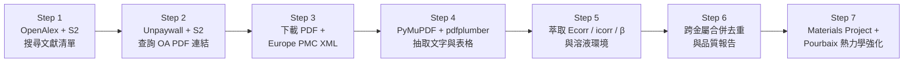

# Tafel Mining — 電化學腐蝕與極化曲線文獻自動探勘工具

自動化搜尋、下載、解析電化學腐蝕與半導體 CMP / 濕蝕刻文獻，萃取極化曲線關鍵參數（$E_{\text{corr}}$、$i_{\text{corr}}$、Tafel 斜率 $\beta_a / \beta_c$、溶液組成、pH、溫度、參考電極），並整合 Materials Project 與 Pourbaix 熱力學特徵，產出可供機器學習與電偶腐蝕模擬使用的結構化資料庫。

---

## 目錄

- [系統運作流程](#系統運作流程)
- [環境需求與快速開始](#環境需求與快速開始)
- [完整指令總覽（macOS / Windows 對照表）](#完整指令總覽macos--windows-對照表)
  - [1. 環境建置與套件安裝](#1-環境建置與套件安裝)
  - [2. 一鍵執行主程式（run_all.py）](#2-一鍵執行主程式run_allpy)
  - [3. 單步驟獨立執行（Step 1 ~ Step 7）](#3-單步驟獨立執行step-1--step-7)
  - [4. 指定單一金屬與環境變數控制](#4-指定單一金屬與環境變數控制)
  - [5. 單元測試](#5-單元測試)
- [設定檔與產出結構](#設定檔與產出結構)
- [相依函式庫說明](#相依函式庫說明)
- [常見問題與排錯指南](#常見問題與排錯指南)

---

## 系統運作流程

整個管線分為 **7 個步驟**（Step 1~ 5 針對各金屬獨立執行，Step 6~ 7 跨金屬整併與特徵強化）：



| 步驟 | 對應腳本 | 主要工作 |
|---|---|---|
| **Step 1** | `step1_search_openalex.py` | 依金屬與 `SEARCH_MODES` 查詢 OpenAlex（與 Semantic Scholar），輸出文獻 metadata CSV |
| **Step 2** | `step2_find_pdf_urls.py` | 透過 Unpaywall（與 Semantic Scholar）依 DOI 找出合法開放取用（OA）PDF 連結 |
| **Step 3** | `step3_download_pdfs.py` | 下載 OA PDF，並自動透過 `europepmc_fetcher.py` 補抓 Europe PMC 開放全文 XML 與結構化表格 |
| **Step 4** | `step4_extract_text.py` | 使用 PyMuPDF 抽取純文字（`.txt`）、pdfplumber 抽取表格（`_tables.json`） |
| **Step 5** | `step5_extract_data.py` | 從文字與表格解析電化學參數、統一單位與電位基準（SHE）、過濾物理離群值，輸出單金屬三張標準表 |
| **Step 6** | `step6_merge.py` | 掃描 `data/` 下所有已完成金屬，跨金屬去重、整併三張核心表並產出 `quality_report.md` |
| **Step 7** | `step7_enrich_data.py` | 推算有效 pH、補齊元素物性、串接 Materials Project API 與 Pourbaix 引擎，輸出 ML 訓練集與電偶腐蝕風險預覽表 |

> **斷點續跑與容錯設計**：`run_all.py` 會為每個金屬啟動獨立子程序，單一金屬失敗不影響其他金屬；已完成的 Step 1 / Step 2 / PDF / 文字檔會自動略過（可用 `--force` 強制重跑）。

---

## 環境需求與快速開始

### 1. 前置需求
- **Python 3.10 以上**（程式使用 PEP 604 `X | None` 型別語法；已於 Python 3.10 ~ 3.14 驗證）
- 穩定的網際網路連線（Step 1~3、Step 7 需存取學術與材料 API）

### 2. 五分鐘上手步驟

1. **建立虛擬環境並安裝套件**（指令見下方 [1. 環境建置與套件安裝](#1-環境建置與套件安裝)）。
2. **設定 API Keys（建議，可大幅避免 429 限速）**：
   將 `.env.example` 複製為 `.env` 並填入你的金鑰（全部留空也能以免費公開額度執行）：
   ```env
   OPENALEX_API_KEY=你的_OpenAlex_Key
   SEMANTIC_SCHOLAR_API_KEY=你的_S2_Key
   MP_API_KEY=你的_Materials_Project_Key
   ```
   並打開 `user_settings.py`，將 `MAILTO` 改成你的 Email（OpenAlex 與 Unpaywall polite pool 用）。
3. **驗證資料庫與設定是否正常**：
   - macOS：`.venv/bin/python run_all.py --check-db`
   - Windows：`.venv\Scripts\python.exe run_all.py --check-db`
4. **先跑單一金屬試水溫**（例如只跑 `Cu`）：
   - macOS：`.venv/bin/python run_all.py Cu`
   - Windows：`.venv\Scripts\python.exe run_all.py Cu`
5. **查看最終產出**：完成後直接查看 `data/merged/` 內的 `electrochemical_database.csv`、`ml_training_dataset.csv` 與 `quality_report.md`。

---

## 完整指令總覽（macOS / Windows 對照表）

> 💡 **小技巧**：建議直接使用 `.venv/bin/python`（macOS）或 `.venv\Scripts\python.exe`（Windows）執行指令，不需每次手動啟用虛擬環境，也能避免 Windows PowerShell 的執行原則（ExecutionPolicy）限制。

### 1. 環境建置與套件安裝

| 操作說明 | macOS / Linux | Windows (PowerShell / CMD) |
|---|---|---|
| 建立虛擬環境 `.venv` | `python3 -m venv .venv` | `py -m venv .venv` |
| 啟用虛擬環境（選用） | `source .venv/bin/activate` | PowerShell: `.venv\Scripts\Activate.ps1`<br>CMD: `.venv\Scripts\activate.bat` |
| 退出虛擬環境 | `deactivate` | `deactivate` |
| 安裝必要相依套件 | `.venv/bin/pip install -r requirements.txt` | `.venv\Scripts\pip.exe install -r requirements.txt` |
| 升級 pip 與相依套件 | `.venv/bin/pip install --upgrade pip -r requirements.txt` | `.venv\Scripts\pip.exe install --upgrade pip -r requirements.txt` |
| 選用安裝 DFT Pourbaix 套件 | `.venv/bin/pip install "mp-api>=0.41.0" "pymatgen>=2024.1.1"` | `.venv\Scripts\pip.exe install "mp-api>=0.41.0" "pymatgen>=2024.1.1"` |
| 複製環境變數範本檔 | `cp .env.example .env` | PowerShell: `Copy-Item .env.example .env`<br>CMD: `copy .env.example .env` |

### 2. 一鍵執行主程式（`run_all.py`）

日常探勘只需操作 `run_all.py`，它會自動依序執行各金屬的 Step 1~5，最後執行 Step 6 跨金屬合併與 Step 7 特徵強化。

> 💡 為求版面精簡，本節以 `python` 代表虛擬環境執行檔：若未先 `activate`，macOS / Linux 請改用 `.venv/bin/python`，Windows 請改用 `.venv\Scripts\python.exe`。

#### 依常見需求選擇指令

| 你的需求 | 指令範例 | 說明 |
|---|---|---|
| **先跑單一／少數金屬試水溫** | `python run_all.py Cu`<br>`python run_all.py Cu Co W` | 只對指定金屬跑完 Step 1~7（符號不分大小寫），適合初次測試 |
| **正式跑完所有預設金屬** | `python run_all.py` | 依 `user_settings.py` 的 `METALS_TO_RUN` 跑完所有金屬與合併強化 |
| **已抓過文獻，只想從中途步驟重跑** | `python run_all.py --from-step 5`<br>`python run_all.py --from-step 6`<br>`python run_all.py --from-step 7` | 跳過耗時的搜尋與下載（支援 `1`~`7`，亦可搭配金屬名稱）：<br>• `5`：重跑參數萃取 + 合併 + 強化<br>• `6`：只重跑跨金屬合併 + 強化<br>• `7`：只重跑 MP / Pourbaix 特徵強化 |
| **只跑指定的局部步驟區間** | `python run_all.py Cu --from-step 2 --to-step 3`<br>`python run_all.py Cu Co --from-step 1 --to-step 3` | 同時指定 `--from-step` 與 `--to-step`（支援 `1`~`7`），可精準只跑其中幾個步驟（例如只跑 Step 2+3，不跑後續 Step 4~7） |
| **保留舊資料，補抓其他主題文獻** | `python run_all.py Cu --search-mode cmp_etch inhibitor --append` | `--search-mode` 可多選（`corrosion`、`cmp_etch`、`inhibitor`、`solvent`、`catalysis`、`all`），搭配 `--append` 統一搜尋 OpenAlex / S2 / Europe PMC 並依 DOI / PMCID 去重合併，Step 2/3 只處理新增論文 |
| **重試先前下載失敗的論文** | `python run_all.py Cu --from-step 3 --to-step 3 --retry-failed`<br>`python run_all.py Cu --from-step 3 --retry-failed` | Step 3 預設會依 `<metal>_download_state.json` 自動略過已下載與先前失敗的論文；換網路環境或想重新補抓失敗清單時加上 `--retry-failed` |
| **忽略快取，從頭強制重抓某金屬** | `python run_all.py Cu --force` | 忽略 Step 1/2 斷點續跑設定，重新查詢 API 並覆寫舊清單 |
| **查看支援金屬／驗證自訂資料庫** | `python run_all.py --list`<br>`python run_all.py --check-db` | `--list` 查看可用金屬清單；編輯 JSON 新增金屬後請跑 `--check-db` 檢查格式 |

#### 進階控制開關（可自由疊加）
- **控制結束步驟**：使用 `--to-step N`（預設 `7`）可停在任意步驟，或用 `--no-merge`（停在 Step 5）、`--no-enrich`（停在 Step 6 合併後、跳過 Step 7），例如：`python run_all.py TiN --from-step 4 --no-enrich`。
- **下載狀態表與離線初始化**：Step 3 會在各金屬 `metadata/` 維護 `<metal>_download_state.json`；舊金屬首次執行時會於本機離線初始化（零網路請求），將已存在檔案記為完成、舊失敗紀錄標記為 `failed_legacy`，之後跑 `--append` 不會重複重試舊失敗論文。
- **查看完整參數說明**：`python run_all.py --help`。

### 3. 單步驟獨立執行（Step 1 ~ Step 7）

> 單獨執行 Step 1~5 時，預設使用 `user_settings.py` 中的 `DEFAULT_METAL`（預設為 `Cu`）；若要切換金屬，請搭配下方第 4 節的 `TAFEL_METAL` 環境變數。

| 步驟 / 說明 | macOS / Linux | Windows (PowerShell / CMD) |
|---|---|---|
| Step 1：搜尋 OpenAlex / S2 文獻 | `.venv/bin/python step1_search_openalex.py` | `.venv\Scripts\python.exe step1_search_openalex.py` |
| Step 2：查詢 Unpaywall / S2 OA PDF 連結 | `.venv/bin/python step2_find_pdf_urls.py` | `.venv\Scripts\python.exe step2_find_pdf_urls.py` |
| Step 3：下載 PDF + Europe PMC 全文 XML | `.venv/bin/python step3_download_pdfs.py` | `.venv\Scripts\python.exe step3_download_pdfs.py` |
| 單獨抓取 Europe PMC 開放全文 XML | `.venv/bin/python europepmc_fetcher.py` | `.venv\Scripts\python.exe europepmc_fetcher.py` |
| Step 4：從 PDF 抽取文字與表格 | `.venv/bin/python step4_extract_text.py` | `.venv\Scripts\python.exe step4_extract_text.py` |
| Step 5：萃取電化學參數與三張單金屬表 | `.venv/bin/python step5_extract_data.py` | `.venv\Scripts\python.exe step5_extract_data.py` |
| Step 6：跨金屬合併、去重與品質報告 | `.venv/bin/python step6_merge.py` | `.venv\Scripts\python.exe step6_merge.py` |
| Step 7：物理與 Pourbaix 特徵強化（預設） | `.venv/bin/python step7_enrich_data.py` | `.venv\Scripts\python.exe step7_enrich_data.py` |
| Step 7：忽略快取重新查詢 Materials Project | `.venv/bin/python step7_enrich_data.py --refresh-cache` | `.venv\Scripts\python.exe step7_enrich_data.py --refresh-cache` |
| Step 7：完全離線模式（僅用快取與內建表） | `.venv/bin/python step7_enrich_data.py --offline` | `.venv\Scripts\python.exe step7_enrich_data.py --offline` |
| Step 7：包含合金與塗層（`alloy` / `coating_composite`） | `.venv/bin/python step7_enrich_data.py --include-alloys` | `.venv\Scripts\python.exe step7_enrich_data.py --include-alloys` |

### 4. 指定單一金屬與環境變數控制

| 環境變數與用途 | macOS / Linux | Windows (PowerShell) | Windows (CMD) |
|---|---|---|---|
| `TAFEL_METAL`：單跑 Step 1~5 時指定金屬（例：`Co`） | `TAFEL_METAL=Co .venv/bin/python step5_extract_data.py` | `$env:TAFEL_METAL="Co"; .venv\Scripts\python.exe step5_extract_data.py` | `set TAFEL_METAL=Co && .venv\Scripts\python.exe step5_extract_data.py` |
| `TAFEL_SEARCH_MODES`：單跑腳本時覆蓋搜尋模式組合 | `TAFEL_SEARCH_MODES="cmp_etch,inhibitor" .venv/bin/python step1_search_openalex.py` | `$env:TAFEL_SEARCH_MODES="cmp_etch,inhibitor"; .venv\Scripts\python.exe step1_search_openalex.py` | `set TAFEL_SEARCH_MODES=cmp_etch,inhibitor && .venv\Scripts\python.exe step1_search_openalex.py` |
| `TAFEL_FORCE_S2_REFRESH=1`：強制重新查詢 Semantic Scholar（忽略本地快取） | `TAFEL_FORCE_S2_REFRESH=1 .venv/bin/python run_all.py Cu --force` | `$env:TAFEL_FORCE_S2_REFRESH="1"; .venv\Scripts\python.exe run_all.py Cu --force` | `set TAFEL_FORCE_S2_REFRESH=1 && .venv\Scripts\python.exe run_all.py Cu --force` |
| `TAFEL_QUIET_CONFIG=1`：靜默載入設定（不印出 banner、不自動建資料夾） | `TAFEL_QUIET_CONFIG=1 .venv/bin/python step6_merge.py` | `$env:TAFEL_QUIET_CONFIG="1"; .venv\Scripts\python.exe step6_merge.py` | `set TAFEL_QUIET_CONFIG=1 && .venv\Scripts\python.exe step6_merge.py` |

> **PowerShell 注意事項**：`$env:VAR="value"` 會在當前視窗持續生效，執行完若想清除可輸入 `Remove-Item Env:TAFEL_METAL`。

### 5. 單元測試

| 操作說明 | macOS / Linux | Windows (PowerShell / CMD) |
|---|---|---|
| 執行全部單元測試 | `.venv/bin/python -m unittest discover -s tests -v` | `.venv\Scripts\python.exe -m unittest discover -s tests -v` |
| 直接執行測試檔案 | `.venv/bin/python tests/test_pipeline_improvements.py` | `.venv\Scripts\python.exe tests\test_pipeline_improvements.py` |

---

## 設定檔與產出結構

### 核心設定檔
- **`user_settings.py`**：**所有日常可自定義參數的唯一入口**，常用調整項目：
  - `MAILTO`：OpenAlex / Unpaywall 聯絡 Email。
  - `METALS_TO_RUN`：預設批次執行的金屬清單（目前支援 13 種：`Cu, Co, W, Ru, Ti, TiN, TaN, WN, MoN, Al, Ta, Mn, Mo`）。
  - `SEARCH_MODES`：可自由多選組合 5 種正交搜尋模組——`corrosion`（一般腐蝕）、`cmp_etch`（CMP／濕蝕刻）、`inhibitor`（多樣化緩蝕劑）、`solvent`（非水／有機／半水／混合溶劑）、`catalysis`（電催化）；預設啟用前 3 項。執行 `run_all.py` 時亦可用 `--search-mode cmp_etch inhibitor` 或 `--search-mode solvent` 臨時組合覆蓋。
  - `MAX_RECORDS_PER_QUERY`：每組關鍵字抓取上限（測試建議 `50`，正式建議 `200`~`300`）。
  - `SKIP_EXISTING_STEP1` / `SKIP_EXISTING_STEP2`：是否啟用斷點續跑。
  - `ENABLE_SEMANTIC_SCHOLAR` / `ENABLE_EUROPEPMC_XML` / `ENABLE_MP_API`：外部資料源開關。
  - `FILTER_OUTLIERS`：是否自動濾除超出物理合理區間的離群值（被濾除的資料會保留於 `*_filtered_outliers.csv`）。
- **`config.py`**：內部設定載入與衍生引擎（讀取 `user_settings.py`、`.env` 與 `metals_db.json`，自動展開關鍵字、路徑與正規表示式，日常無須手動編輯）。
- **`metals_db.json`**：各金屬的英文名稱、化合物清單、專屬 CMP 查詢詞與 $E_{\text{corr}}$ 合理電位區間。
- **`materials_physics.json`**：元素與化合物的物理常數、標準電極電位與 Pourbaix 熱力學參數。
  > 新增自訂金屬時，請同步編輯這兩個 JSON 檔，並執行 `run_all.py --check-db` 確認無誤。

### 輸出目錄結構
```text
data/
├── <METAL>/                                # 各金屬獨立目錄（例如 Cu, Co, TiN...）
│   ├── metadata/
│   │   ├── <metal>_tafel_metadata.csv      # Step 1 搜尋結果（OpenAlex + S2 + Europe PMC）
│   │   ├── <metal>_tafel_with_pdf.csv      # Step 2 PDF 連結與 PMCID 清單
│   │   ├── <metal>_download_state.json     # Step 3 下載狀態表（已完成 / 失敗紀錄）
│   │   └── <metal>_s2_cache.json           # Semantic Scholar 本地快取
│   ├── pdfs/                               # Step 3 下載的 OA PDF
│   ├── texts/                              # Step 3/4 產出的純文字 (.txt) 與表格 (_tables.json)
│   └── extracted/                          # Step 5 單金屬結構化資料與離群值紀錄
└── merged/                                 # Step 6 & Step 7 最終合併輸出目錄
    ├── material_properties.csv             # 材料物性總表
    ├── solution_properties.csv             # 溶液組成與 pH/溫度標準化總表
    ├── electrochemical_database.csv        # 跨金屬去重後的電化學參數主表
    ├── quality_report.md                   # 資料覆蓋率與品質統計報告
    ├── mp_cache.json                       # Materials Project API 本地快取
    ├── ml_training_dataset.csv             # Step 7 機器學習訓練資料集
    └── galvanic_risk_preview.csv           # Step 7 電偶腐蝕風險配對預覽表
```

---

## 相依函式庫說明

所有必要套件皆定義於 `requirements.txt`：

| 套件名稱 | 建議版本 | 用途與版本說明 |
|---|---|---|
| `requests` | `>=2.31.0` | 呼叫 OpenAlex、Unpaywall、Semantic Scholar、Europe PMC、Materials Project REST API 及下載 PDF（2.31+ 修補安全漏洞） |
| `pandas` | `>=2.0.0` | 所有步驟的資料表處理、合併、去重與 CSV 讀寫（2.0+ 提供穩定現代 API 與效能改善） |
| `numpy` | `>=1.24.0` | Step 5 表格/文字數值運算與 Step 7 電化學熱力學計算（顯式宣告以避免依賴傳遞缺失） |
| `pymupdf` | `>=1.24.0` | Step 4 高速 PDF 文字抽取（**必須 `>=1.24.0`** 才支援 `import pymupdf as fitz`） |
| `pdfplumber` | `>=0.10.0` | Step 4 PDF 結構化表格抽取 |
| `tqdm` | `>=4.66.0` | Step 1~5 終端機進度條顯示 |
| `mp-api`（選用） | `>=0.41.0` | Step 7 完整 DFT `PourbaixDiagram` 查詢；**未安裝時自動改用內建 REST API v2** |
| `pymatgen`（選用） | `>=2024.1.1` | 搭配 `mp-api` 進行完整 DFT Pourbaix 相圖計算；**未安裝時自動改用內建熱力學引擎** |

---

## 常見問題與排錯指南

| 問題現象 | 常見原因 | 解決方式 |
|---|---|---|
| **`ModuleNotFoundError: No module named 'pymupdf'`** | 1. 沒使用 `.venv` 的 Python<br>2. 安裝到舊版 `PyMuPDF < 1.24.0` | 確認使用 `.venv/bin/python`（或 `.venv\Scripts\python.exe`），並執行 `pip install --upgrade "pymupdf>=1.24.0"`。 |
| **API 回傳 `429 Too Many Requests`** | OpenAlex 或 Semantic Scholar 公開 IP 免費額度達上限 | 在 `.env` 填入 `OPENALEX_API_KEY` 與 `SEMANTIC_SCHOLAR_API_KEY`；若無 S2 Key，可在 `user_settings.py` 將 `SEMANTIC_SCHOLAR_DELAY` 調大或暫設 `ENABLE_SEMANTIC_SCHOLAR = False`。 |
| **Step 3 大量 PDF 回傳 `403 Forbidden`** | 出版商網站（如 Elsevier/Wiley）的 WAF 防爬蟲阻擋 | 屬正常現象。程式已內建 **Europe PMC 開放全文 XML** 自動補位（免 Key、無 403 且含原生結構化表格），不影響後續萃取。 |
| **Step 5 顯示「沒有任何文字檔，略過」** | `data/<METAL>/texts/` 內沒有 `.txt` 檔（Step 3/4 未執行或下載全數失敗） | 先跑 `--from-step 3` 或單獨執行 `europepmc_fetcher.py` 取得開放全文。 |
| **Step 6 合併時缺少某個金屬** | 該金屬的 `extracted/` 下缺少三張必要 CSV 之一（`material_properties`、`solution_properties`、`electrochemical_database`） | 對該金屬重跑 `--from-step 5`，確認三張 CSV 皆已產出後再執行 `step6_merge.py`。 |
| **Step 7 顯示 Offline 或沒裝 `mp-api`** | 未設定 `MP_API_KEY` 或 Python 3.13/3.14 尚未安裝 `mp-api`/`pymatgen` | **不影響執行**：無 `mp-api` 時會自動透過 REST API v2 抓取 MP 資料；無 `MP_API_KEY` 時也會用內建熱力學常數與 Pourbaix 引擎完成輸出。 |
| **Windows PowerShell 無法執行 `Activate.ps1`** | Windows 預設禁止執行未簽署腳本（ExecutionPolicy） | 最簡單解法：**不需 activate**，直接使用 `.venv\Scripts\python.exe ...`；或執行 `Set-ExecutionPolicy -Scope CurrentUser RemoteSigned`。 |
| **改了 `user_settings.py` 但重跑沒生效** | Step 1/2 啟用了斷點續跑，或 Semantic Scholar / MP 讀到舊快取 | 加 `--append`（增量合併）或 `--force`（強制覆寫）重跑 Step 1/2；重抓 S2 請加 `TAFEL_FORCE_S2_REFRESH=1`；重抓 MP 請跑 `step7_enrich_data.py --refresh-cache`。 |
| **新增金屬後報錯** | `metals_db.json` 或 `materials_physics.json` 格式或欄位不完整 | 執行 `run_all.py --check-db`，依 `[ERROR]` / `[WARN]` 提示補齊欄位。 |
